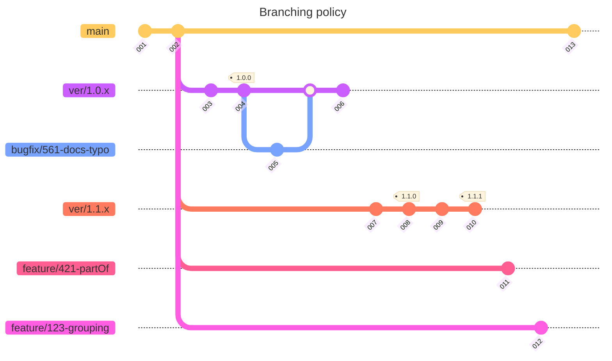

# Git branching policy

### What is this?

## Principles

The main working branch is the development, which displays the state of the most current standard proposal being developed. Version branches are to be found on branches starting with ver for example ver/1.1.x. The official versions of the standard are marked with tags, for example 1.0.0, and can be also found in GitHub realeses.

main = future
version branches = maintained release lines
tags = exact released artifacts

<!-- Guide how to use Mermaid GitGraph: https://mermaid.js.org/syntax/gitgraph.html. -->

<!-- cherry-pick id:"08" parent:"12" -->
<!-- merge main id:"MERGE" -->
	
## Naming convention

**Commit name** should be...
**Branch name** should be...
**Tag name** should be...

	