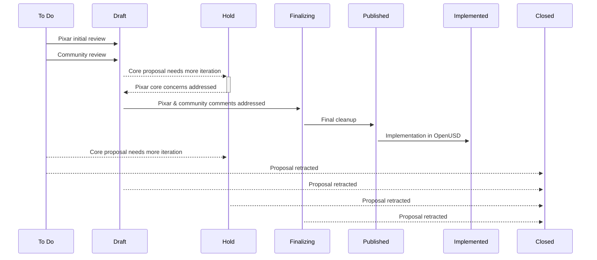

# Git branching policy

```
main
├── release/4.3
│   ├── feature/4.3-bugfix-a
│   └── hotfix/4.3.2
└── release/4.4
    ├── feature/new-capability
    ├── feature/api-update
    └── hotfix/4.4.1
```

<!-- Guide how to use Mermaid GitGraph: https://mermaid.js.org/syntax/gitgraph.html. -->
```mermaid
---
title: Branching policy
config:
  theme: 'base'
---
gitGraph
   commit id: "01"
   commit id: "02"
   branch ver/1.0.x
   checkout ver/1.0.x
   commit id: "03"
   branch bugfix/561-docs-typo
   checkout bugfix/561-docs-typo
   commit id: "04"
   merge ver/1.0.x
   checkout ver/1.0.x
   commit id: "05"
   checkout main
   branch ver/1.1.x 
   checkout ver/1.1.x 
   commit id: "06"
   commit id: "07" tag: "1.1.0"
   commit id: "08"
   commit id: "09" tag: "1.1.1"
   checkout main
   branch feature/421-partOf
   checkout feature/421-partOf
   commit id: "10"
   branch feature/123-grouping
   checkout feature/123-grouping
   commit id: "11"
   checkout main   
   commit id: "12"
   cherry-pick id:"08" parent:"12"
```
	
diagram



python
```Python
import test

a = 2.0

print(a)

```


stl
```stl
solid cube_corner
  facet normal 0.0 -1.0 0.0
    outer loop
      vertex 0.0 0.0 0.0
      vertex 1.0 0.0 0.0
      vertex 0.0 0.0 1.0
    endloop
  endfacet
  facet normal 0.0 0.0 -1.0
    outer loop
      vertex 0.0 0.0 0.0
      vertex 0.0 1.0 0.0
      vertex 1.0 0.0 0.0
    endloop
  endfacet
  facet normal -1.0 0.0 0.0
    outer loop
      vertex 0.0 0.0 0.0
      vertex 0.0 0.0 1.0
      vertex 0.0 1.0 0.0
    endloop
  endfacet
  facet normal 0.577 0.577 0.577
    outer loop
      vertex 1.0 0.0 0.0
      vertex 0.0 1.0 0.0
      vertex 0.0 0.0 1.0
    endloop
  endfacet
endsolid
```


geojson
```geojson
{
  "type": "FeatureCollection",
  "features": [
    {
      "type": "Feature",
      "id": 1,
      "properties": {
        "ID": 0
      },
      "geometry": {
        "type": "Polygon",
        "coordinates": [
          [
              [-90,35],
              [-90,30],
              [-85,30],
              [-85,35],
              [-90,35]
          ]
        ]
      }
    }
  ]
}
```