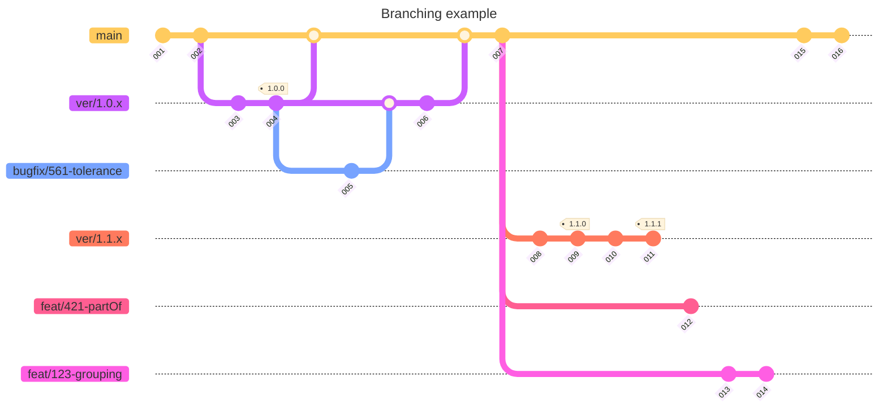

# Git branching policy

### What is this?

This document defines the Git branching strategy used for the project and establishes common rules for managing development, releases, maintenance, and contributions. 

If you are not familiar with these version control terms, you should look at [Introduction to GitHub](./GitHub_intro.md). Here is a brief summary: a **commit** is a snapshot of the file changes from a specific point in time. Commits form the project's history and allow changes to be tracked, reviewed, and reverted if necessary. A **branch** is a named line of development that points to a sequence of commits. Branches allow multiple streams of work to proceed independently. A **merge** combines changes from one branch into another, for example integrating completed work on a new feature into the main branch. The resulting history preserves the relationship between the source and target branches. A **tag** is a permanent reference to a specific commit, and is used to identify immutable record of released versions. A **cherry-pick** is an act of copying one or more specific commits from one branch to another  without merging the entire branch history.

## Principles

The **main** working branch is called the `main` and it displays the state of the most current active development for next future version being developed. Consider it a work-in-progress standard proposal.  The `main` is usually ahead of version branches, but it should not be a dumping ground for untested work.

**Version branches** are for the maintained release lines of each major and minor version of the standard. For example `ver/1.1.x` holds all updates and patches to release 1.1 (first minor update of first major version). Please avoid applying hotfixes directly to the version branches. Instead, upload them at `main` and cherry-pick to version branches.

The official versions of the standard are marked with **tags**. Tags are exact, versioned, immutable released versions. The name follows SemVer standard: Major.Minor.Patch. For example, `1.0.12` interprets as the twelfth patch to the firt major release, and there are no minor versions. It is possible to also tag other important moments in the project evolution or provide more information, such as 'alpha', '1.0.1_sent-for-voting' or '1.0.1_as-sent-to-ISO'. All tags can be found in [GitHub realeses](https://github.com/buildingSMART/template/releases).

Apart from these branches, there can also be **feature branches**, **documentation branches** and **bugfix branches**. The main difference is that feature branch implementes new functionality, documentation is explaining or clarifying the existing functionality in the text documentation or testcases, while the bugfix is solving some reported problem. These branches can be ahead of `main`, and should be merged once completed.
These should be short-lived branches created to address a specific need or defect, and deleted after it has been resolved. These branches should contain the issue number they refer to. If the issue doesn't exist - create it (except for simple fixes like a typo).

| branch type | example name | purpose |
|--|--|--|
| main | main | active development for next future version |
| version | v1.0.x | maintained release lines of each version |
| feature | feat/421-coolThing | implementes new functionality |
| bugfix | fix/561-tolerance  | solving a reported problem |
| docs | doc/docsTypo  | explaining or clarifying existing functionality |
| prototype | proto/new-approach  | no release promise |
| (tags) | 1.0.1 |  exact, immutable released artifacts |

<!-- Guide how to use Mermaid GitGraph: https://mermaid.js.org/syntax/gitgraph.html. -->

<!-- cherry-pick id:"08" parent:"12" -->
<!-- merge main id:"MERGE" -->

After implementing a bugfix or feature to an existing line of standard, if the change is meaningful, apply forward-porting (propagation) to later branches and `main`.
	
## Naming convention

**Commit name** should be...
**Branch name** should be...

For shortlived branches (feature, docs, bugfix), the naming convention is: `<branch-type>/<issue-id>-<short-description>`, for example: `feat/100-new-function`

**Tag name** should be...

## Backward compatibility

**Backward compatibilty** means that a newer implementation can continue to work correctly with data, interfaces, or behaviors that were valid under an earlier version. The code written against older version should continue to compile, run, and behave correctly on newer file version without modification, even though some functionality added in newer version will not be supported. This depends on implementation specific approach, as unknown features coming from a future version might still cause errors. A file compliant with older version should open in software implementing the newer version. A file complaint with newer version might not need to open correctly in software implementing only the older version.

|Change|Backward compatible?|Reason|
|--|--|--|
|Add new optional feature. | Yes | Old files will load, new features don't need to be supported in older software.   |
|Add optional parameter to the end of a `xs:sequence` | Yes | Existing callers still work.   |
|Add optional parameter to the beggining of a `xs:sequence` | No | `xs:sequence` is order specific. An older file will probably be missing the new parameter.  |
|Remove a parameter|No| The old files will still contain, causing an error in newer software. |
|Rename a parameter|No| Same reason as removing. |

Major releases **don't need to be** backward compatible. For example 3.0.0 can be missing some functionailty existing in 2.4.0.

Minor releases **need to be** backward compatibile within one major line.

## Forking policy

xx

