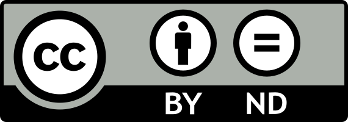

# Copyright Notice

Copyright © 1996-2026 buildingSMART International Limited. All rights reserved.

Any technical documentation made available by buildingSMART International Limited is the copyrighted work of buildingSMART International Limited and is owned by buildingSMART International Limited. It may be photocopied, used in software development, or translated into another computer language without prior written consent from buildingSMART International Limited, provided that full attribution is given. Prior written consent is required if changes are made to the technical specification.

### No Warranty Notice
This material is delivered to you as is, and buildingSMART International Limited makes no warranty of any kind with regard to it, including, but not limited to, the implied warranties as to its accuracy or fitness for a particular purpose. Any use of the technical documentation or the information contained therein is at the user's own risk. Documentation may include technical or other inaccuracies or typographical errors. buildingSMART International Limited shall not be liable for errors contained therein or for incidental or consequential damages in connection with the furnishing, performance or use of the material. The information contained in this document is subject to change without notice.

### Trademark Notice
The terms buildingSMART, openBIM, "The Home of openBIM", Industry Foundation Class, IFC, ifcXML, and the logos (including, but not limited to the four colour interlinked rings symbol) are trademarks of buildingSMART International Limited and should be given appropriate credit. Membership of any Chapter affiliated to buildingSMART International Limited, as indicated by the appellation buildingSMART Member, or use of a trademark in conjunction with any documentation developed using IFC documentation, does not imply responsibility for or approval of that documentation by buildingSMART International Limited.

### Copyright Exclusion Notice
Parts of the IFC documentation contain material based on other international standards. The status of this material is clearly indicated throughout the documentation and is excluded from the Copyright of buildingSMART International Limited.

## Correspondence Notice
Inquiries should be addressed to buildingSMART International at [contact@buildingsmart.org](mailto:contact@buildingsmart.org).

# License

What you are allowed to do with the content of the repository depends on the type of content.

| Content Type | License |
|---|---|
| Final Publications | CC BY-ND 4.0 |
| Draft specification, documentation, schema | buildingSMART Draft Collaboration Licence |
| Software, tooling | Apache License 2.0 |
| Test files, examples, and test suites | CC BY 4.0 (not ND) |

## Final Publications License - the CC BY-ND 4.0

Formal releases (static and immutable) are published under the `Creative Commons Attribution-NoDerivatives 4.0 International` license (CC BY-ND 4.0). View the full license text at: [CC BY-ND 4.0](https://creativecommons.org/licenses/by-nd/4.0/deed.en).

You are **free to share** — copy and redistribute the material in any medium or format for any purpose, even commercially, under the following terms:
- **You must give appropriate credit** and provide a link to the license. You may do so in any reasonable manner, but not in any way that suggests the licensor endorses you or your use.
- If you remix, transform, or build upon the material, **you may not distribute the modified material**.

[Creative Commons - Frequently Asked Questions](https://creativecommons.org/faq/)

## buildingSMART Draft Collaboration Licence

> [!WARNING]
> NOT IN FORCE

Draft Contribution Licence ... for the normative draft materials, backed by a Contributor Agreement that either assigns accepted contributions to bSI or gives bSI a very broad perpetual, irrevocable, sublicensable licence that expressly covers publication, modification, translation, integration into future editions, and sublicensing into ISO-facing outputs. 

## Software - the Apache License 2.0

> [!WARNING]
> NOT IN FORCE

The software and tooling are under the **Apache 2.0**, and license unless a particular example is itself normative or intended to remain under central control. 

[Apache License, Version 2.0 | Apache Software Foundation](https://www.apache.org/licenses/LICENSE-2.0)

## Test files, examples, and test suites - CC BY 4.0 (not ND)

> [!WARNING]
> NOT IN FORCE
