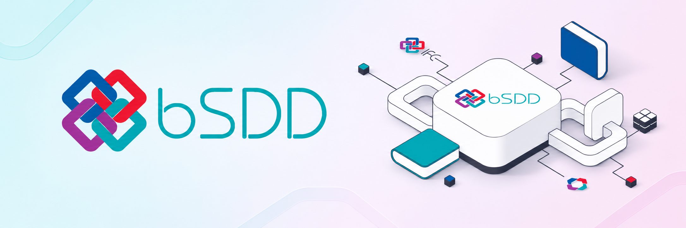

> [!WARNING]
> This repository is a draft template, not an actual buildingSMART standard, project or service. It only contains boilerplate clauses and configuration.

This is the official buildingSMART International GitHub repository for XYZ. 

> [!TIP]
> New to GitHub? It is a platform designed to help people collaborate on projects, track changes, discuss improvements, and manage development workflows in a transparent and organised way. It is built on top of the Git distributed version control system. If you're new to GitHub terms like Issue, Pull Request, Commit or Branch, read this: [GitHub Introduction](./.github/GitHub_intro.md).

## Repository structure

The default branch is called `main` and should contain the latest state of the development. Consider it a work-in-progress standard proposal. Version branches are for the maintained release lines of each major and minor version of the standard, for example `ver/1.1.x`. See the [Branching policy](./.github/BRANCHING.md).

Files are organised in this project as follows:

├── [schema](/schema) _- this is where the JSON Schema files are stored_ \
├── [docs](/docs) _- this is the source of documentation_ \
│   ├── [implementationDocumentation](/implementationDocumentation) \
│   └── [userManual](/userManual) \
├── [output](/output) \
├── [examples](/examples) - _example files to help use and implement the standard_ \
├── [tests](/tests) - _test suit to ensure consistency of implementation_ \
└── [.github](/.github) - _GitHub-specific policies, workflows, configuration, automation, and templates_

Tooling should be kept outside of the key repository.

## Contribution

Contributions are most welcome. All contributors who want to make changes to files need to sign the Contributor License Agreement (CLA). Read more on [Contributing](./contributing.md). We also ask all users to follow our:
* [Code of Conduct](./.github/CODE_OF_CONDUCT.md) (where you can also file a complaint if you witness unacceptable behaviour)
* [Branching policy](./.github/BRANCHING.md).
* [Security policy](./.github/SECURITY.md) (where you can also report a vulnerability)

If you are seeking support, read [Support](./.github/SUPPORT.md) page.

The projects are governed by buildingSMART processes and policies. You can read more in the [Governance](./.github/GOVERNANCE.md) section.

## Releases

The versioning of standards follows the SemVer standard: `Major.Minor.Patch`. For example, 1.0.12 is interpreted as the twelfth patch to the first major release, and there are no minor versions.

The official versions of the standard are published on buildingSMART pages. Important milestones are also marked here on GitHub with appropriate tags. Tags are exact, versioned, immutable released versions. It is possible to also tag other important moments in the project evolution or provide more information, such as 'alpha', '1.0.1_sent-for-voting' or '1.0.1_as-sent-to-ISO'. All tags can be found in GitHub releases.

The official builds, containing compiled and deliverable files, are automatically published here:
- GitHub Repository of all openBIM standards, both official releases and in development: https://github.com/buildingSMART/Standards-builds
- The HTML version: https://standards.buildingsmart.org/IFC/DEV/IFC4_3/

## Relevant pages

- [buildingsmart.org](https://www.buildingsmart.org/)
- [IFC standard page](https://www.buildingsmart.org/standards/bsi-standards/industry-foundation-classes/)
- [IDS standard page](https://www.buildingsmart.org/standards/bsi-standards/information-delivery-specification-ids/)
- [buildingSMART Forum](https://forums.buildingsmart.org/)
- [Implementer Assembly events](https://www.buildingsmart.org/implementers-assembly/)
- [Software Certification](https://www.buildingsmart.org/compliance/software-certification/)
  
## Copyright & License

© buildingSMART International Ltd. All rights reserved. 

Different licenses apply to parts of the repository. Read the [License](./license) for more details. Formal releases are licensed under [Creative Commons Attribution-NoDerivatives 4.0 International](https://creativecommons.org/licenses/by-nd/4.0/deed.en) (CC BY-ND 4.0).
